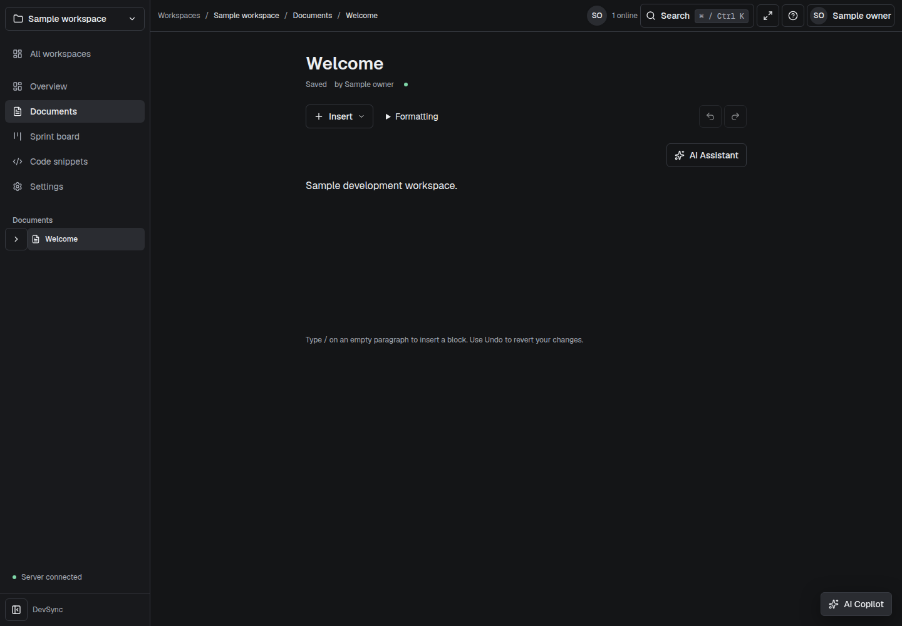

# DevSync

A workspace for collaborative documents, tasks and code snippets. DevSync uses Clerk identities, server-side workspace roles and PostgreSQL row-level security. This upgrade has open release gates: **44 High container findings per runtime image**, an unresolved broad pointer-drag E2E journey, and missing production/performance verification. See the [final report](docs/FINAL_REPORT.md) for measured results and limits.



Actual fixture-backed UI from Phase5a-3, not a mockup. [Mobile light editor](docs/quality/phase5a-3/accepted-final/light-390-default.png) · [Dashboard](docs/ui/after/dashboard/final/dark-1440-ready.png) · [Design system](docs/ui/DESIGN.md).

## Quickstart

Prerequisites: Git and Docker with Compose. Clone the upgrade branch:

```sh
git clone --branch upgrade/enterprise https://github.com/Kevinbastin/devsync.git
cd devsync
```

Start the local stack with one command:

```sh
docker compose up --build --detach --wait
```

Open http://localhost:3000. Compose initializes local credentials, migrates and seeds PostgreSQL, and starts Redis, the backend, frontend and worker. **Without Clerk keys the app shows setup guidance and protected access stays unavailable.** This does not provision provider accounts or enable fixture login. Follow the [runbook](docs/RUNBOOK.md) for Clerk keys, identity IDs, environment variables, least-privilege database roles and production deployment. Do not reuse disposable local credentials in production.

`docker compose down` stops the stack and retains data volumes. Seed identity changes on an existing volume need review; creating real Clerk users does not automatically remap seeded memberships. Never delete volumes containing valuable data as a setup shortcut.

## What exists

| Area                 | Implemented behavior and boundaries                                                                                                                                                                                                                                       |
| -------------------- | ------------------------------------------------------------------------------------------------------------------------------------------------------------------------------------------------------------------------------------------------------------------------- |
| Dashboard and shell  | Recent documents, assigned tasks, recorded activity, quick actions, workspace navigation, command palette, theme selection and mobile navigation drawer.                                                                                                                  |
| Documents            | TipTap blocks, tables, task lists, code blocks, nested documents and Yjs/Hocuspocus collaboration with durable journaling. Viewers remain read-only on the server. Local CRDT persistence does not constitute a complete offline/PWA product.                             |
| Tasks                | Workspace task boards, assignments, priorities, detail drawer and keyboard move control. Native pointer drag still has an open browser journey failure.                                                                                                                   |
| Snippets             | Store, filter and copy source text. Current client filtering covers title/language/description; it is not code full-text search. Host execution is disabled.                                                                                                              |
| Members and settings | Owner/editor/viewer roles, explicit invitation acceptance, section search and role-restricted AI usage. Session administration, API-token management and account-lifecycle UI are incomplete.                                                                             |
| AI                   | Optional bounded streaming, configured Groq/OpenAI fallback and atomic per-user/workspace request allowances. Retrieved references are candidates, not verified claim support; request counts are not currency billing. [Cost and safety limits](docs/AI_COST_SAFETY.md). |
| Decision receipts    | Optional manual source-bound decisions; `FEATURE_DECISION_RECEIPTS=true`, default off. [Design and limits](docs/features/decision-receipts.md).                                                                                                                           |
| Snippet safety       | Optional heuristic preflight and confirmed redacted save; `FEATURE_SNIPPET_SAFETY=true`, default off. No guarantee of secret-free content. [Design and limits](docs/features/snippet-safety-preflight.md).                                                                |
| Async digest         | Optional evidence-only in-app digest of eligible recorded creation events; `FEATURE_ASYNC_DIGEST=true`, default off. No AI or scheduled messaging. [Design and limits](docs/features/async-digest.md).                                                                    |

Feature flags must be configured consistently as described in their feature docs. Advanced editor/board features, complete import/export, i18n, billing UI and PWA remain deferred. No end-to-end document encryption, unlimited scale, legal compliance, support SLA or production readiness is claimed. The server can read workspace content; repository-secret encryption is a separate control.

## Stack and structure

Next.js16.4.3, React19.2.4, TypeScript, Tailwind v4, Radix primitives, Lucide and Geist fonts; Express4, Prisma5, PostgreSQL with pgvector, Redis/BullMQ, Socket.IO, Yjs/Hocuspocus and TipTap3. Package manifests and lockfiles are authoritative for versions. Clerk authenticates users; Groq/OpenAI are optional external AI services.

```text
backend/src/           API, authorization, collaboration, services, workers
backend/prisma/        schema, forward migrations, seed, database operations
backend/testing/       isolated test-only browser authentication/harness
backend/openapi.json   generated OpenAPI contract
frontend/src/          Next.js routes, app shell, UI components, client state
frontend/testing/      generated fixture adapter support
frontend/tests/        Node and component tests
backend/docker/        local initialization and backend service tooling
frontend/docker/       frontend entrypoint and health tooling
.github/workflows/     quality, security and gated deployment workflows
docs/                  design, authorization, operations and retained evidence
tools/                 CI and quality orchestration
```

## Development and scripts

Both manifests support Node `^22.12.0 || ^24.0.0 || >=26.0.0`; recorded checks use Node22. Install with `npm --prefix backend ci` and `npm --prefix frontend ci`. Configure private local environment files using the examples and [runbook](docs/RUNBOOK.md). Run `npm run dev` in each application directory in separate terminals; default ports are5000 and3000. Docker is needed for disposable database integration tests.

| Script                              | Backend                                                  | Frontend                                         |
| ----------------------------------- | -------------------------------------------------------- | ------------------------------------------------ |
| `dev` / `start`                     | Development API / compiled API                           | Development / built Next.js server               |
| `lint`, `format:check`, `typecheck` | Static checks, including seed/testing types              | Static checks                                    |
| `test`                              | Jest, including database/realtime tests                  | Node runner followed by Vitest                   |
| `build`                             | Prisma client generation and TypeScript                  | Next.js build; recorded gates use `-- --webpack` |
| `worker`                            | Dedicated embedding/outbox and queue worker              | —                                                |
| `db:migrate`, `db:seed`             | Privileged migration deploy / explicitly authorized seed | —                                                |
| `openapi:check`, `openapi:generate` | Validate / regenerate tracked API artifact               | —                                                |
| `test:e2e`                          | Playwright config; prefer the isolated helper below      | —                                                |

[CONTRIBUTING.md](CONTRIBUTING.md) gives exact gate commands and `node tools/ci/browser.mjs <suite>` usage. The test fixture login is isolated from the normal application and must never become production authentication. Never run seed or destructive test commands against production data.

## Documentation

- [Architecture and diagrams](docs/ARCHITECTURE.md), [API and OpenAPI](docs/API.md), [authorization matrix](docs/AUTHZ_MATRIX.md).
- [Operations runbook](docs/RUNBOOK.md), [security](SECURITY.md), [privacy and legal-review gaps](docs/PRIVACY.md).
- [Final report and evidence](docs/FINAL_REPORT.md), [progress and remaining work](docs/PROGRESS.md), [changelog](CHANGELOG.md).

There is no tracked LICENSE grant. Maintainer confirmation is required before publishing licensing or contribution terms.
