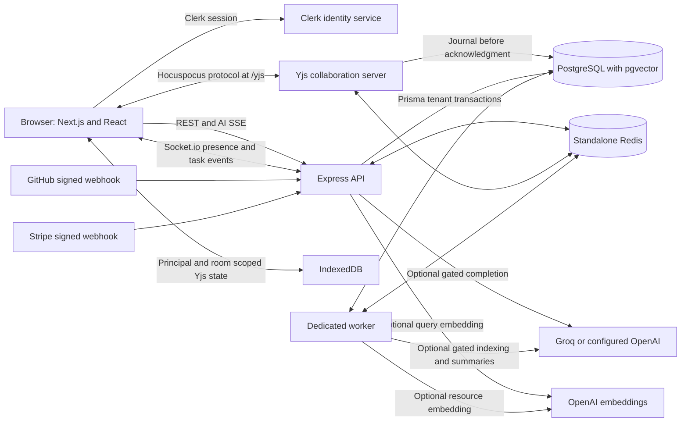
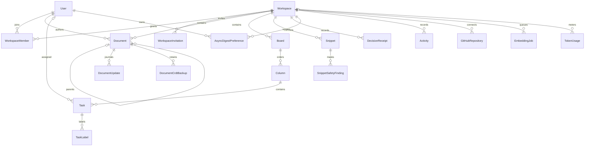
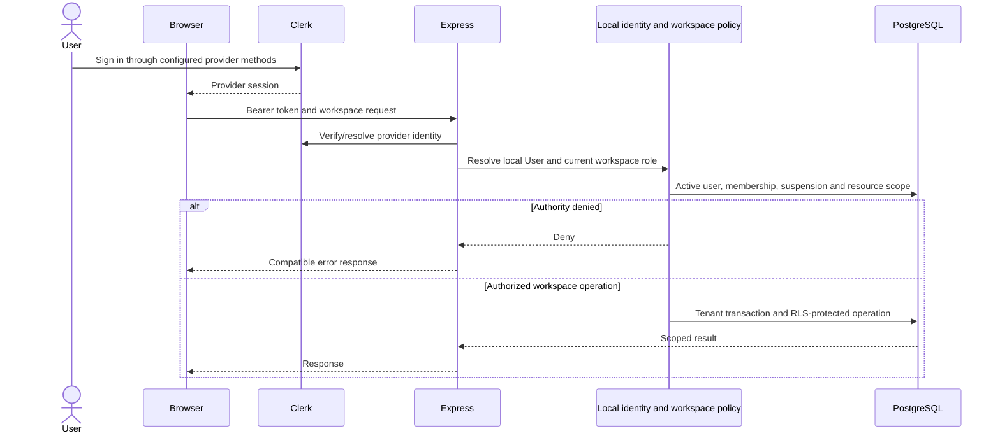
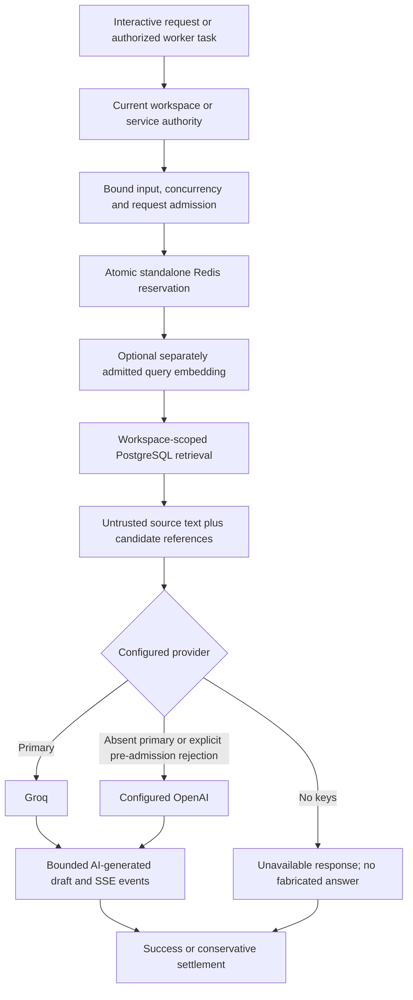
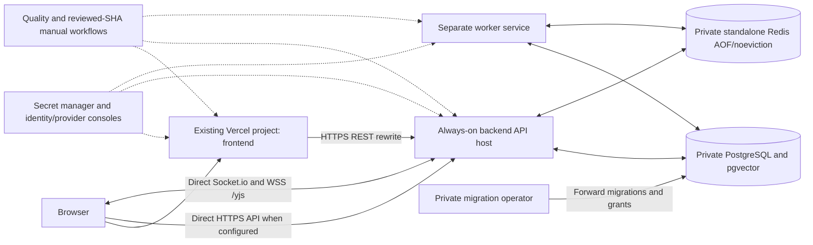

# Architecture

This describes the tracked implementation on `upgrade/enterprise` through the identity lifecycle work, not a running production installation. [FINAL_REPORT.md](FINAL_REPORT.md) separates source behavior from executed tests. [ARCHITECTURE_CURRENT.md](ARCHITECTURE_CURRENT.md) is the historical Phase0 snapshot.

## Identity and lifecycle additions

Production HTTP and initial realtime identity verification bind a verified Clerk JWT to an active provider session for the same subject/session. Socket.IO and Yjs also recheck provider status through their existing ongoing authorization audits. The shared adapter has a bounded positive cache (at most5 seconds, monotonic clock), a1500ms provider deadline and fail-closed errors; JWT expiry, active local principal, current tenant membership and source policy remain separate requirements. Provider availability, API limits and propagation must be validated before production. See [provider adapter](../backend/src/security/provider-sessions.ts), [HTTP identity](../backend/src/security/authentication.ts) and [realtime identity](../backend/src/security/realtime-identity.ts).

The frontend waits for successful local identity synchronization before displaying signed-in workspace children and offers uncached-token retry and native Clerk sign-out. Account settings list/revoke only the authenticated user's provider sessions and show a non-destructive deletion plan. Owner workspace settings use compatible v2 lifecycle routes for exact-name-confirmed ownership transfer and export-review requests. Transfer promotes an active same-tenant member and demotes the caller to EDITOR in the existing locked tenant transaction, then invalidates collaboration access. The additive, forced-RLS WorkspaceExportRequest table records manual review only; there is no export bundle, erasure service or automatic provider account deletion. [Routes](../backend/src/routes/lifecycle.routes.ts), [migration](../backend/prisma/migrations/202611080001_export_requests/migration.sql), [verification and rollback](quality/identity-lifecycle/README.md). Real two-account provider acceptance remains unverified.

## System



Next16.4.3/React19.2.4, strict TypeScript, Tailwind4 semantic tokens, Radix primitives, Lucide icons and Geist fonts form the frontend. TipTap3.32.2 edits Yjs content. Express4, Prisma5.22, PostgreSQL/pgvector, Socket.io, Hocuspocus, Redis and BullMQ form the backend. Local containers use PostgreSQL16 and pinned Node22/Alpine application bases. Versions are taken from the [frontend](../frontend/package.json) and [backend](../backend/package.json) manifests/locks and [Compose](../docker-compose.yml), not a compatibility promise for arbitrary versions.

The API starts HTTP, Socket.io and Hocuspocus. A dedicated worker starts BullMQ consumers and the SQL embedding-outbox poller. API polling is optional via RUN_EMBEDDING_WORKER_IN_API. Worker process liveness does not establish progress. Binary ingestion uses a separate bounded, credential-free extraction service; Compose isolates it on an internal network with read-only filesystem and memory/CPU/PID limits. Without INGESTION_EXTRACTOR_URL binary ingestion fails closed; text uploads remain local. See quality/release-correctness/README.md for parser budgets and actual verification limits. Cloudinary service code is not an exposed upload product. Sources: [server](../backend/src/server.ts), [worker](../backend/src/worker.ts), [queues](../backend/src/lib/queue.ts), [embedding runner](../backend/src/services/embedding-runner.ts).

## Data model and tenant boundary

The diagram is a relational subset; [schema.prisma](../backend/prisma/schema.prisma) and forward SQL migrations are authoritative. Arrow names describe relations, not additional API permissions.



User identity is global; WorkspaceMember grants OWNER/EDITOR/VIEWER authority. Document ancestry is tenant-bound through a composite key. Task tenancy derives through column/board. Vectors have1536 dimensions. DocumentUpdate/DocumentCrdtBackup are content-bearing records, not harmless diagnostics. Decision receipts bind a document/task source revision; source withdrawal hides derivatives. Snippet findings store types and constant masks, never detected values. Digest preferences/checkpoints are personal and tenant-scoped; the digest reads recorded eligible activity rather than storing an AI summary. Additional models include SCIM hashes/mappings, delivery deduplication and bounded create-idempotency receipts.

Workspace policy checks current active principal, unsuspended workspace and current membership. Mutations use transactional locks; tenant transactions set PostgreSQL session-local authority and RLS policy. Runtime roles must not own tables, be superuser or bypass RLS. Global identity/service/SCIM/admin paths have distinct policies; see [AUTHZ_MATRIX.md](AUTHZ_MATRIX.md), [workspace policy](../backend/src/security/workspace-policy.ts) and [tenant client](../backend/src/lib/tenant-prisma.ts). A feature flag is not authority. Database cascade declarations do not provide cross-system privacy erasure; restrictions/backups can block deletion.

## Authentication and workspace authorization



Clerk manages login, provider sessions and optional dashboard-configured methods; the repository does not implement custom password/refresh-cookie rotation or a general sessions/MFA settings product. Local Clerk IDs differ from database User IDs. Invitation acceptance also requires the matching verified email. Real Clerk setup/sign-in is human work, not supplied by seeds. The development fixture binds an alternate authentication strategy only in its isolated test server; production/Compose never exposes /__test login. Keyless local mode renders setup guidance and private API requests remain denied. Sources: [authentication](../backend/src/security/authentication.ts), [auth routes](../backend/src/routes/auth.routes.ts), [realtime identity](../backend/src/security/realtime-identity.ts), [fixture](../backend/testing/fixture-auth.ts).

## Real-time document flow

The client tracks connection and pending acknowledgments per Y.Doc, so room/account changes cannot borrow a prior replica's Saved state. Access denial/4403 disables editing and identifies pending local edits as unconfirmed. Local IndexedDB persistence is asynchronous and distinct from remote native journal acknowledgment. The [recovery verification](quality/realtime-recovery/README.md) exercises actual browser clients, compaction and application-server SIGKILL against real local PostgreSQL/Redis with fixture identity. No historical restore UI or new schema/wire format is added.

```mermaid
sequenceDiagram
  participant B as TipTap and local Y.Doc
  participant I as IndexedDB
  participant H as Hocuspocus
  participant P as PostgreSQL journal and snapshot
  participant R as Redis fanout
  participant O as Other authorized client
  B->>H: Room document:workspaceId:documentId plus fresh token
  H->>P: Current identity, tenant, role and source checks
  H-->>B: Scoped sync; viewer read-only
  B->>I: Persist local Yjs operations
  B->>H: Bounded writable update
  H->>P: Commit deduplicated DocumentUpdate
  P-->>H: Commit succeeds
  H-->>B: Native sync acknowledgment
  H->>R: Configured collaboration fanout
  R-->>O: Merge authorized Yjs operations
  H->>P: Row-locked snapshot and JSON projection compaction
  B->>H: Uncached token renewal
  H->>P: Recheck same principal and current authority
```

The WebSocket endpoint is `/yjs`; the room travels in Hocuspocus messages, not a documented `/yjs/<documentId>` HTTP path or plain y-websocket contract. Socket.io transports presence/task events, not document text. The client renews tokens periodically; the server updates both the live connection and copied hook context, without relaxing expiry or membership checks. A journal acknowledgment is stronger than an unsent/offline edit. There is no complete installable/offline PWA or guaranteed remote cancellation/cache wipe. Effective CRDT journal appends invalidate embedding hashes and queue the existing indexing outbox atomically under current writer policy. Duplicate state does not churn revisions/jobs, and compaction preserves a completed hash. Provider completion remains eventual; continuous edits can postpone indexing, and local tests do not establish live-provider freshness. Sources: [collaboration server](../backend/src/services/collaboration-server.ts), [journal](../backend/src/services/crdt-journal.ts), [browser replica](../frontend/src/lib/local-first-yjs.ts), [CRDT operations](CRDT_OPERATIONS.md).

## AI flow and disclosure



Global per-user and workspace daily/monthly request allowances precede AI calls; embeddings and background work also participate. These are reservations, not authoritative token/currency accounting. Provider fallback is restricted to configured keys and safe rejection cases; ambiguous/partial work is not replayed. Prompt/source text is untrusted. Retrieved references are candidate sources, not proof every generated claim is supported. No evaluation corpus/scores are bundled; the runner is a scaffold. Redis loss, lease recovery and ambiguous remote billing have explicit limits. Provider-configured background indexing/agents can send content without a separate interactive prompt click. No in-repository training pipeline is implemented, and provider retention/training terms are not guaranteed by code. Sources: [AI admission](../backend/src/services/ai-quota.ts), [provider policy](../backend/src/services/ai-provider.ts), [AI routes](../backend/src/routes/ai-v3.routes.ts), [cost and safety](AI_COST_SAFETY.md), [privacy](PRIVACY.md).

## Deployment topology



This is the configured target, not verified hosted deployment. Local Compose additionally runs bootstrap/migration/seed helpers and keyless setup guidance. API/worker receive runtime credentials only. Production migration is explicit; pre-deploy migrate-status is not DDL. Railway configuration preserves account secrets; protected environments, domains, TLS, CI settings and actual host isolation need human setup. Current local runtime scans show0 High/Critical, backend4 Medium/frontend0 findings; unchanged required CI gates still need hosted execution. See the [current inventory](../VULNERABILITIES.md), including musl support limits. Terraform/Kubernetes material is not a verified alternative rollout. Sources: [RUNBOOK.md](RUNBOOK.md), [Railway IaC](../.railway/railway.ts), [Vercel config](../frontend/vercel.json), [workflows](../.github/workflows), [runtime risk inventory](quality/phase5a-3/VULNERABILITIES.md).

## GitHub execution evidence

The existing repository HMAC webhook now commits authenticated-body proofs and versioned PR/review/check state with its tenant task effects. Stable provider IDs/SHAs and separate provider/receipt timestamps support owner-only v2 execution reads. Signed App lifecycle withdrawal marks repository access disconnected; webhook/job admission denies it and the lazy settings panel hides prior evidence. Live access is otherwise unverified; deployment remains unknown. See [local verification, migration/rollback and deferred live setup](quality/github-trail/README.md). No actual provider/deployment success follows from local signed fixtures.

## Permission-aware lexical search

The additive v2 workspace search/source-open routes use current central READ_ROLES and tenant RLS over existing source tables. PostgreSQL full text with explicit simple configuration and expression GIN indexes reads committed TipTap text/local resources; there is no copied knowledge store. Receipt source visibility/feature flags and owner-only connected PR evidence are rechecked in each query. The page defaults to lexical, needs no provider key and labels read-time projection evaluation separately from source update time. Existing semantic/AI retrieval stays separate and rejects invalidated embedding hashes. CRDT appends already project content and schedule the existing outbox atomically. [Contracts, migration/rollback, evidence and limitations](quality/search-indexing/README.md).

## Decision execution evidence (local implementation)

The existing flagged decision receipts can have append-only execution events. Current workspace roles and the receipt's source are checked on every timeline read and write; linked tasks are rechecked in the same workspace, while linked GitHub PR metadata remains owner-only and disappears when its repository binding is unavailable. Check runs are associated with the recorded PR head SHA and reviews with the PR number, with provider and observation timestamps and bounded results. Signed webhook facts are labeled as such; current provider access and deployment are not inferred. Authorized workspace deletion cascades receipt event removal. See [verification and outstanding deployment evidence](quality/decision-execution/README.md).


## Grounded assistant previews

The optional grounded preview endpoint reuses the existing completion gateway/quota and lexical knowledge service. Strict structured citations and proposal schemas have no mutation capability; source authority and source identity/content metadata are rechecked after provider I/O. Existing stream contracts remain. See [implementation, flags and evaluation limitations](quality/grounded-ai/README.md).


## Phase 10 automation boundary

When enabled, workspace rules and event/audit/lease records use forced tenant RLS. Owner approval precedes a worker claim; membership, rule version and source are rechecked at execution. The Redis job carries an opaque execution ID and encrypted tenant locator, while transactional idempotency and leases keep local activities single-effect under retry. Human task assertions and signed GitHub webhook observations retain distinct provenance. No external write or AI action is performed by the new automation worker. CI linked-status mutation is unavailable until independent verification and the linked-work graph exist. See [verification and rollout](quality/automation/README.md).

## Phase 12 local replica lifecycle

The live Yjs hook uses the compatible atomic snapshot adapter (`draft-storage.ts` / `draft-persistence.ts`) instead of a simultaneous y-indexeddb writer. Local transaction receipts, remote journal acknowledgement and native rejection remain distinct. Per-replica bounds, terminal storage errors and transactional purge tombstones protect retained data. BroadcastChannel coordinates current-version tabs; old adapters require closure. Live import/reset is disabled pending authorized generation fencing. See [offline draft verification](quality/offline-drafts/README.md) for limits and rollback behavior.
