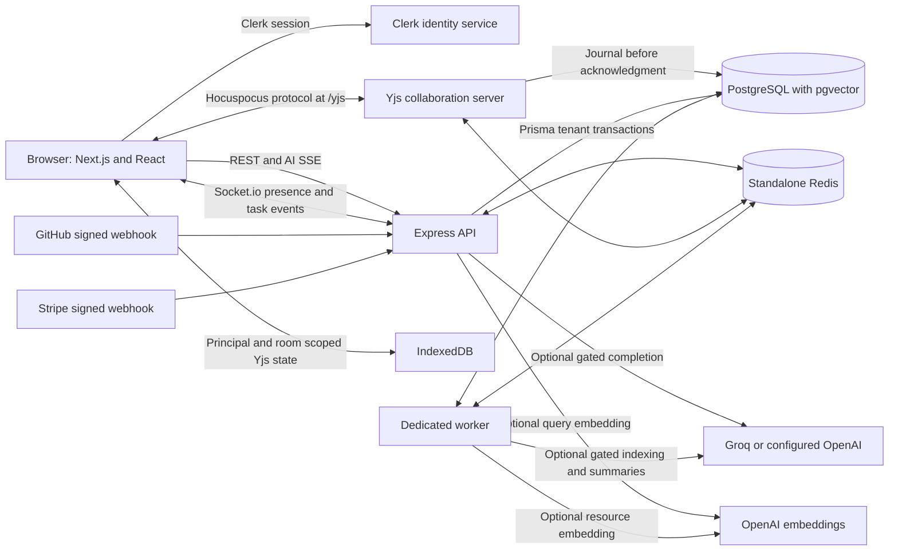
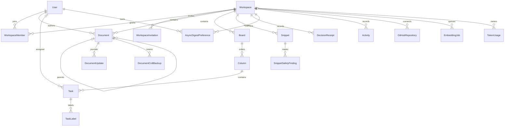
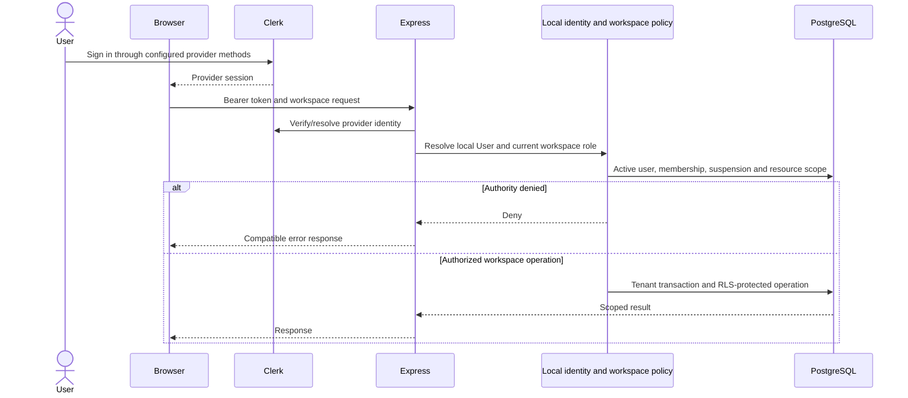
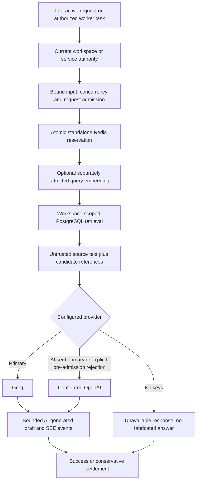
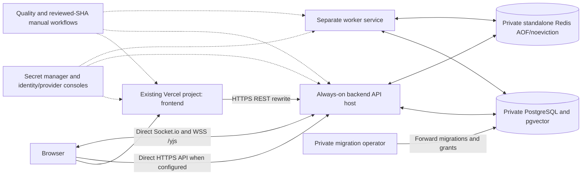

# Architecture

This describes the tracked implementation on `upgrade/enterprise` after the runtime and Kanban follow-up, not a running production installation. [FINAL_REPORT.md](FINAL_REPORT.md) separates source behavior from executed tests. [ARCHITECTURE_CURRENT.md](ARCHITECTURE_CURRENT.md) is the historical Phase0 snapshot.

## System



Next16.4.3/React19.2.4, strict TypeScript, Tailwind4 semantic tokens, Radix primitives, Lucide icons and Geist fonts form the frontend. TipTap3.32.2 edits Yjs content. Express4, Prisma5.22, PostgreSQL/pgvector, Socket.io, Hocuspocus, Redis and BullMQ form the backend. Local containers use PostgreSQL16 and pinned Node22/Alpine application bases. Versions are taken from the [frontend](../frontend/package.json) and [backend](../backend/package.json) manifests/locks and [Compose](../docker-compose.yml), not a compatibility promise for arbitrary versions.

The API starts HTTP, Socket.io and Hocuspocus. A dedicated worker starts BullMQ consumers and the SQL embedding-outbox poller. API polling is optional via RUN_EMBEDDING_WORKER_IN_API. Worker process liveness does not establish progress. The ingestion queue name does not mean isolated OCR/PDF processing is delivered: extraction still has documented isolation/deadline gaps. Cloudinary service code is not an exposed upload product. Sources: [server](../backend/src/server.ts), [worker](../backend/src/worker.ts), [queues](../backend/src/lib/queue.ts), [embedding runner](../backend/src/services/embedding-runner.ts).

## Data model and tenant boundary

The diagram is a relational subset; [schema.prisma](../backend/prisma/schema.prisma) and forward SQL migrations are authoritative. Arrow names describe relations, not additional API permissions.



User identity is global; WorkspaceMember grants OWNER/EDITOR/VIEWER authority. Document ancestry is tenant-bound through a composite key. Task tenancy derives through column/board. Vectors have1536 dimensions. DocumentUpdate/DocumentCrdtBackup are content-bearing records, not harmless diagnostics. Decision receipts bind a document/task source revision; source withdrawal hides derivatives. Snippet findings store types and constant masks, never detected values. Digest preferences/checkpoints are personal and tenant-scoped; the digest reads recorded eligible activity rather than storing an AI summary. Additional models include SCIM hashes/mappings, delivery deduplication and bounded create-idempotency receipts.

Workspace policy checks current active principal, unsuspended workspace and current membership. Mutations use transactional locks; tenant transactions set PostgreSQL session-local authority and RLS policy. Runtime roles must not own tables, be superuser or bypass RLS. Global identity/service/SCIM/admin paths have distinct policies; see [AUTHZ_MATRIX.md](AUTHZ_MATRIX.md), [workspace policy](../backend/src/security/workspace-policy.ts) and [tenant client](../backend/src/lib/tenant-prisma.ts). A feature flag is not authority. Database cascade declarations do not provide cross-system privacy erasure; restrictions/backups can block deletion.

## Authentication and workspace authorization



Clerk manages login, provider sessions and optional dashboard-configured methods; the repository does not implement custom password/refresh-cookie rotation or a general sessions/MFA settings product. Local Clerk IDs differ from database User IDs. Invitation acceptance also requires the matching verified email. Real Clerk setup/sign-in is human work, not supplied by seeds. The development fixture binds an alternate authentication strategy only in its isolated test server; production/Compose never exposes /__test login. Keyless local mode renders setup guidance and private API requests remain denied. Sources: [authentication](../backend/src/security/authentication.ts), [auth routes](../backend/src/routes/auth.routes.ts), [realtime identity](../backend/src/security/realtime-identity.ts), [fixture](../backend/testing/fixture-auth.ts).

## Real-time document flow

```mermaid
sequenceDiagram
  participant B as TipTap and local Y.Doc
  participant I as IndexedDB
  participant H as Hocuspocus
  participant P as PostgreSQL journal and snapshot
  participant R as Redis fanout
  participant O as Other authorized client
  B->>H: Room document:workspaceId:documentId plus fresh token
  H->>P: Current identity, tenant, role and source checks
  H-->>B: Scoped sync; viewer read-only
  B->>I: Persist local Yjs operations
  B->>H: Bounded writable update
  H->>P: Commit deduplicated DocumentUpdate
  P-->>H: Commit succeeds
  H-->>B: Native sync acknowledgment
  H->>R: Configured collaboration fanout
  R-->>O: Merge authorized Yjs operations
  H->>P: Row-locked snapshot and JSON projection compaction
  B->>H: Uncached token renewal
  H->>P: Recheck same principal and current authority
```

The WebSocket endpoint is `/yjs`; the room travels in Hocuspocus messages, not a documented `/yjs/<documentId>` HTTP path or plain y-websocket contract. Socket.io transports presence/task events, not document text. The client renews tokens periodically; the server updates both the live connection and copied hook context, without relaxing expiry or membership checks. A journal acknowledgment is stronger than an unsent/offline edit. There is no complete installable/offline PWA or guaranteed remote cancellation/cache wipe. CRDT projections invalidate embedding hashes; automatic freshness for every continuous CRDT edit remains an open integration limit, not a live-code/stale-doc product. Sources: [collaboration server](../backend/src/services/collaboration-server.ts), [journal](../backend/src/services/crdt-journal.ts), [browser replica](../frontend/src/lib/local-first-yjs.ts), [CRDT operations](CRDT_OPERATIONS.md).

## AI flow and disclosure



Global per-user and workspace daily/monthly request allowances precede AI calls; embeddings and background work also participate. These are reservations, not authoritative token/currency accounting. Provider fallback is restricted to configured keys and safe rejection cases; ambiguous/partial work is not replayed. Prompt/source text is untrusted. Retrieved references are candidate sources, not proof every generated claim is supported. No evaluation corpus/scores are bundled; the runner is a scaffold. Redis loss, lease recovery and ambiguous remote billing have explicit limits. Provider-configured background indexing/agents can send content without a separate interactive prompt click. No in-repository training pipeline is implemented, and provider retention/training terms are not guaranteed by code. Sources: [AI admission](../backend/src/services/ai-quota.ts), [provider policy](../backend/src/services/ai-provider.ts), [AI routes](../backend/src/routes/ai-v3.routes.ts), [cost and safety](AI_COST_SAFETY.md), [privacy](PRIVACY.md).

## Deployment topology



This is the configured target, not verified hosted deployment. Local Compose additionally runs bootstrap/migration/seed helpers and keyless setup guidance. API/worker receive runtime credentials only. Production migration is explicit; pre-deploy migrate-status is not DDL. Railway configuration preserves account secrets; protected environments, domains, TLS, CI settings and actual host isolation need human setup. Current local runtime scans show0 High/Critical, backend4 Medium/frontend0 findings; unchanged required CI gates still need hosted execution. See the [current inventory](../VULNERABILITIES.md), including musl support limits. Terraform/Kubernetes material is not a verified alternative rollout. Sources: [RUNBOOK.md](RUNBOOK.md), [Railway IaC](../.railway/railway.ts), [Vercel config](../frontend/vercel.json), [workflows](../.github/workflows), [runtime risk inventory](quality/phase5a-3/VULNERABILITIES.md).
