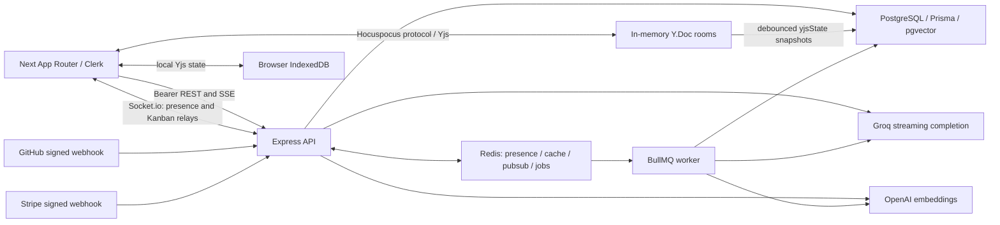

> Historical snapshot: use [ARCHITECTURE.md](ARCHITECTURE.md) for the current source-backed architecture and [FINAL_REPORT.md](FINAL_REPORT.md) for measured limits. The observations below are retained as audit history.

> This is the Phase0 architecture snapshot. Phase1b runtime changes are documented in [CRDT_OPERATIONS.md](CRDT_OPERATIONS.md), [API_OPERATIONS.md](API_OPERATIONS.md), ADR007–009 and [PROGRESS.md](PROGRESS.md); do not treat the snapshot persistence/API/telemetry descriptions below as the current implementation.

> Phase0 architecture snapshot. Phase1a now uses Next16.4.3, aligned TipTap3.32.2, Zod4, disabled host execution, repaired permission boundaries, a source-backed migration baseline/tenant hierarchy constraint and an explicit seed. Authentication still uses Clerk; the requested custom cookie/password system is not implemented. See PROGRESS.md for current limits.

# Current architecture — observed Phase 0

Reviewed 2026-10-31; source inventory covers 153 tracked files before audit additions. The user's historical brief and README are not the current architecture. Runtime/source evidence is in `audit-evidence/`; every registered operation is detailed in [AUTHZ_MATRIX.md](AUTHZ_MATRIX.md).

## Processes and modules

Frontend is Next.js **16.2.4** App Router, React **19.2.4**, TypeScript strict mode and Tailwind **v4**. Clerk supplies authentication pages/provider/proxy, Axios REST calls attach Clerk bearer tokens, React Context provides identity/socket state, Zustand holds a global sync indicator, and Yjs/IndexedDB handles local editor state. There is no SWR dependency or SWR usage. Native HTML drag events implement the current board; dnd-kit packages are installed but not used. TipTap v3 uses collaboration, a custom cursor extension, StarterKit, highlighting, links and task lists. Several installed TipTap extensions are not configured in the editor (image/table/code-block-lowlight); imported OCR table JSON therefore needs editor schema compatibility testing.

Routes: landing `/`; login/signup and sign-in/sign-up aliases; `/dashboard`; workspace overview, docs list, individual docs, kanban, snippets and settings under `/workspace/[id]`; `/settings/billing`; `/superadmin`. Next route handlers implement cookie reset and a service-authenticated kill-switch proxy. Global layout includes Clerk, theme/auth/socket providers, toaster and sync status. Dashboard layout adds sidebar, command palette and copilot. Search palette downloads full resource lists and filters locally rather than using the server unified search route. Activity feed polls every 12s. Snippets are React-escaped plain `<pre><code>` with 12 selectable language labels. Settings/billing/history contain static, nonfunctional elements (AUDIT H05/H06/H10).

Backend is Express **4** on a Node HTTP server; strict TypeScript compiles to CommonJS `dist`. Prisma **5.22** targets PostgreSQL with pgvector. `app.ts` registers Helmet, fixed-origin credentialed CORS, 10MB JSON/raw-body capture, URL encoding, trace context, Clerk middleware, Morgan, global rate limiting, routes, health/readiness, 404 and error middleware. `server.ts` attaches Socket.io and a separate `ws` upgrade handler for Hocuspocus on `/yjs*`; it optionally polls PostgreSQL embedding jobs. A separate `worker.ts` runs BullMQ embedding/task-completion/PR-summary consumers. Redis backs caching, Socket.io pub/sub, presence, idempotency and queues. There is no dedicated Redis deployment in Kubernetes manifests; runtime secrets, ingress controllers, CRDs, monitoring and backing data services must be supplied externally.

The diagram shows intended connections in source, not a claim all paths function. In particular, PostgreSQL embedding producer jobs do not reach the dedicated BullMQ embedding worker.

## Data model

| Models | Relationships and important fields |
|---|---|
| User | Unique clerkId and email; profile, isActive, global USER/SUPER_ADMIN; related memberships, authored documents/snippets, assigned tasks, activities and SCIM identities. No password or refresh-token columns. |
| Workspace / WorkspaceMember | Workspace unique slug, optional Clerk organization/SAML metadata, Stripe customer/subscription and token cap/suspension; membership unique userId+workspaceId with OWNER/EDITOR/VIEWER. No invitation or ownerId entity. |
| Document | Workspace, author and optional parent Document; JSON content plus binary yjsState, 1536 vector/hash, published/archive booleans and timestamps. Parent FK is not composite tenant-bound. |
| Board / Column / Task / TaskLabel | Workspace -> board -> ordered columns -> ordered tasks -> labels; task has optional globally unique taskKey, assignee User, priority, due date, embedding/hash. No per-task workspace column, version or order uniqueness. |
| Snippet | Workspace, author, code/language/description and embedding/hash. |
| GitHubRepository / GitHubWebhookDelivery | Repository globally unique external ID, workspace binding, encrypted webhook secret, opened/merged target column IDs; global unique delivery ID ledger. Target column IDs are plain strings checked in controllers. |
| EmbeddingJob | Unique resourceType+resourceId, status/attempts/runAfter/error; no resource FK. |
| Activity | User/workspace message, metadata/type/time. |
| ScimProvisioningToken / ScimExternalIdentity | Workspace token hash/revocation; workspace+externalId unique mapping to global User. |
| TokenUsage | Workspace usage with globally unique requestId, token count/source and optional Stripe meter event ID. |

Workspace deletion cascades memberships, boards/columns/tasks/labels, documents/snippets/activities, repository links, SCIM records and usage. Document author and parent relations have separate FK restrictions; archive is soft deletion only. Scalar FK indexes are largely absent; explicit vector HNSW indexes are in SQL, not Prisma schema. RLS is FORCE-enabled for Document/Snippet/Task only, expecting `app.current_tenant_id` set LOCAL in a transaction. Many callers do not use that facade (G01); PostgreSQL superusers bypass RLS.

Four incremental SQL migrations add enterprise identity/vector/Yjs, RLS, SCIM and billing. No baseline creates original tables. Schema `clerkId` non-null and migration nullable status differ. `db:seed` refers to nonexistent `prisma/seed.ts`. No database mutations or migrations were executed by this audit.

## REST API and authorization

`/api/auth`: sync, get/patch me. `/api/workspaces`: create/list/detail/update/delete, activities/search, member invite/update/remove, GitHub repository configuration, nested document/board/snippet list/create. `/api/documents/:id`: get/patch/archive. `/api/tasks`: board column create, column update/delete, column task create, `/tasks/:taskId` update/delete/move (double tasks in full URL is current contract). `/api/snippets`: execute plus update/delete. `/api/ai/complete`: streamed completion. `/api/workspaces/:id/documents/ingest`: multipart ingestion. `/scim/v2/Users`: POST/PATCH/DELETE custom provisioning. `/api/webhooks/github` and `/api/webhooks/stripe`: signature verified events. `/api/superadmin`: metrics/kill-switch with service token or DB system role. `/api/health` liveness and `/api/ready` DB/config readiness.

Role middleware on workspace routes resolves membership from URL workspace. Document/snippet/task mutation controllers mostly derive workspace via the target entity. Profile mass assignment, unbound member IDs, column creation, hierarchy IDs, webhook task references and collaboration checks undermine that model. See exhaustive matrix instead of inferring security from route names.

## Identity/session flow

Clerk frontend components perform sign-in/up; proxy protects nonpublic routes. AuthProvider obtains Clerk session token, installs a token getter and calls `/api/auth/sync`. Express Clerk middleware verifies session and authMiddleware resolves local User by clerkId, provisioning via Clerk user lookup if absent. `/auth/sync` has a bearer verification fallback. Frontend auth user ID is the Clerk ID while server membership/activity user IDs are local Prisma IDs. Profile PATCH uses original body after validation (D01).

REST uses Authorization bearer tokens and Axios withCredentials. Socket.io reads handshake.auth.token and verifies via Clerk backend; Hocuspocus authenticates protocol token similarly. Client providers capture a token at initialization. No application-managed access/refresh JWT rotation, local password hashing/reset or email verification flow remains. Logout calls Clerk signOut; reset GET clears browser cookies but does not implement provider session revocation. Provider tenant configuration for cookie flags, expiry, reuse/revocation, password strength, MFA and email verification is external and unverified. IndexedDB room data is not user-scoped or cleared on logout. SCIM creates synthetic clerkIds and manipulates memberships/global users, but isActive is not enforced consistently.

## Collaboration semantics and failure scenarios

Document editing **is a real Yjs CRDT**, not last-write-wins document text over Socket.io. TipTap collaboration applies Yjs updates, IndexeddbPersistence saves local state, and Hocuspocus transports synchronization/awareness. Rooms are `document:<workspaceId>:<docId>`, `kanban:<workspaceId>`, `workspace:<workspaceId>` or bare document IDs. Only rooms with documentId have server persistence. Hocuspocus loads/saves full encoded Yjs state through unscoped Prisma operations, debounce 3s/max10s. JSON projection is not updated by CRDT store.

| Scenario | Source-supported behavior and limits |
|---|---|
| Two users, same paragraph | Yjs text merges concurrent operations; no proven text LWW protocol. Concurrent legacy JSON import is unsafe, titles remain REST LWW, selection positions for AI replacement are not mapped through intervening remote edits. |
| Offline then reconnect | IndexedDB retains document edits; provider can resync updates. No atomic legacy initialization or user-isolated cache. Kanban changes are whole JSON values and failed REST writes have no retry outbox. |
| 10+ editors | No benchmark/load test available. Room size/count not bounded by app policy; per-event Socket.io rate limit does not cover Hocuspocus updates. |
| Restart mid-edit | Abrupt loss during debounce can lose unsaved server state; clients may replay cached updates but no durable server acknowledgment contract. Store catches failures. |
| Ordering/duplicates | Yjs updates are designed to merge idempotently; application JSON overwrite/import can still lose intent. Socket relays have no sequence/version/event deduplication or durable replay. Kanban DB position moves are not atomic. |
| Multiple API replicas | Socket.io can install Redis adapter once initial ping succeeds. Hocuspocus has no Redis/multipod fanout and full snapshots can overwrite concurrent states. |
| Reconnect storm | Providers reconnect but tokens captured once; request Redis health checks can hang. No measured storm performance, aggregate connection limit or server replay load cap. |
| Presence/disconnect | Per-socket workspace tracking cleans user presence on leave/disconnect, but per-user single record mishandles tabs; TTL only refreshed at join, empty memory maps remain, wrong frontend DTO fields. |

Socket input events: workspace:join/leave, cursor:update, kanban:task-created/updated/deleted/moved, error and disconnect. Output: workspace:users, cursor:updated, four Kanban events, activity:new, workspace:suspended and error. Join and mutation relays lack membership/role verification. Hocuspocus room authentication does not bind document IDs to supplied workspace or mark viewers read-only. No synthetic concurrent-user execution was performed without isolated identities/database fixtures.

## AI, ingestion and automation

Interactive completion performs token balance preflight, then checks workspace membership, embeds query via OpenAI if configured, retrieves top workspace-scoped vector matches (documents/snippets/tasks), streams sources and Groq tokens as SSE. Default completion model is `openai/gpt-oss-20b`, max output 1024; not Llama3. Embedding default is text-embedding-3-small with 1536 dimensions. Retrieval returns [] on provider/query error; unified search falls back to keyword search. No documented external workspace data is mixed into scoped SQL, but archived docs remain eligible and request context is client-supplied.

Provider keys are server env only; no NEXT_PUBLIC Groq key found. Document text, snippet code, tasks and PR metadata may leave the tenant to AI vendors by design. No prompt-body logging is intentionally implemented, although SDK exceptions and general logs can include error details; inspect deployed telemetry/log redaction before asserting zero leakage. Prompt injection can direct unsafe HTML rendering. Frontend parses SSE per network chunk and renders copilot/editor previews through an unsanitized Markdown converter.

Balance preflight checks suspendedAt and aggregate monthly TokenUsage only in production with Stripe configured. Completion metering estimates input characters after response finishes; no output/retrieval metering or atomic reservation. Offline AI map reconciliation trusts a bounded client-estimated reservation and processes only first 20 entries. Task agent uses an Opossum Groq/OpenAI fallback gateway; PR agent and interactive streaming do not share it. Automation is not quota-metered.

Ingestion accepts authenticated multipart PDF/image/text, buffers max25MB, checks editor membership after buffering, extracts PDF text or English OCR, converts JSON and writes a document/activity and queues embedding. Runs in API, no OCR queue/deadline. Frontend upload URL is hardcoded localhost. Cloudinary service exists but no registered route invokes it. Native snippet execution launches host interpreters with inherited process.env; this is not a sandbox.

Signed GitHub events record deliveries before processing push/issues/PR; PR transitions use referenced global task keys and enqueue PR summaries if Redis available. Done task moves enqueue summary jobs. Workers append a JSON summary document/activity; no unified Yjs projection. PostgreSQL EmbeddingJob producer and BullMQ embedding consumer mismatch prevents dedicated worker indexing. Stripe webhook updates subscription/billing state but there is no implemented checkout/portal UI/API in tracked routes.

## Deployment, operations and checks

README recommends local postgres16 Docker and db push; Compose instead uses pgvector postgres15 on host5433, Redis7 AOF with allkeys-lru, API/web Docker builds but no worker/migration service. Backend Docker runs as default root and includes dev dependencies; frontend builds standalone then runs nonroot. Frontend public environment values must exist during build, but Compose supplies runtime variables, and Clerk/Yjs build arguments are absent. `.env.example` exists for backend only, omitting Redis/billing/superadmin and several runtime flags. Ignored local env files exist and were not published.

DEPLOYMENT describes Vercel/Render/Oracle/Neon with old JWT requirements. Railway config and independent GitHub deploy workflow also exist. Main CI installs, runs optional lint/test, builds, builds images, scans with Trivy, creates SBOM/attestations and publishes to GHCR. Optional scripts conceal missing backend lint/frontend tests; independent Railway deploy has no quality dependency.

Infrastructure proposes AWS encrypted Multi-AZ RDS/DR and clustered Redis through Terraform; Kubernetes Argo Rollouts API/web, worker Deployment, CPU HPAs, KEDA and Prometheus canary analysis; ArgoCD tracks main and digest image updates. HCL needs validation (terraform unavailable), Redis cluster client compatibility is unresolved, KEDA watches wrong queue keys, and API ingress omits Yjs/Socket.io paths. Cluster services/secrets, certificates, ingress/Argo/KEDA/monitoring installation and DB baseline/migration run are not supplied. Nothing here proves a currently running Vercel/Railway/Kubernetes deployment.

Health, readiness, global errors, Morgan/console logging and OTEL scaffolding exist. Logging is not consistently structured; trace_id is propagated but not fully joined as W3C traceparent to all jobs. Shutdown hooks close HTTP/CRDT/socket/Redis/Prisma/telemetry, but no drain deadline. No measured SLO or validated restore/DR exercise is available.

Final checks: both builds and generated-client backend/frontend type-check pass; backend test compilation failures and frontend lint failure persist. E2E skips absent authenticated fixtures. `audit-evidence/RESULTS.md` records exact commands and environmental errors; screenshots include protected-route login redirects, explicitly not authenticated UI coverage.
