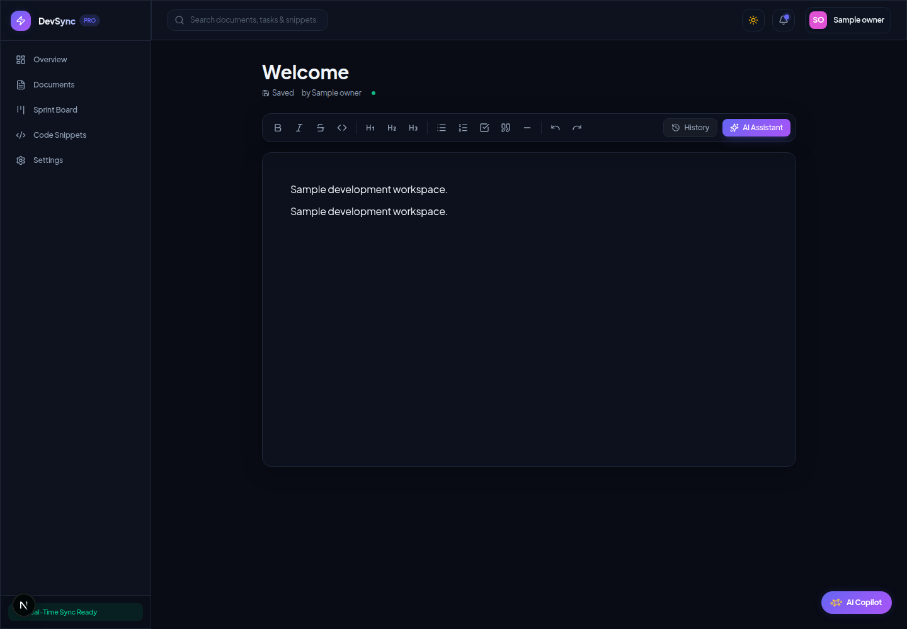
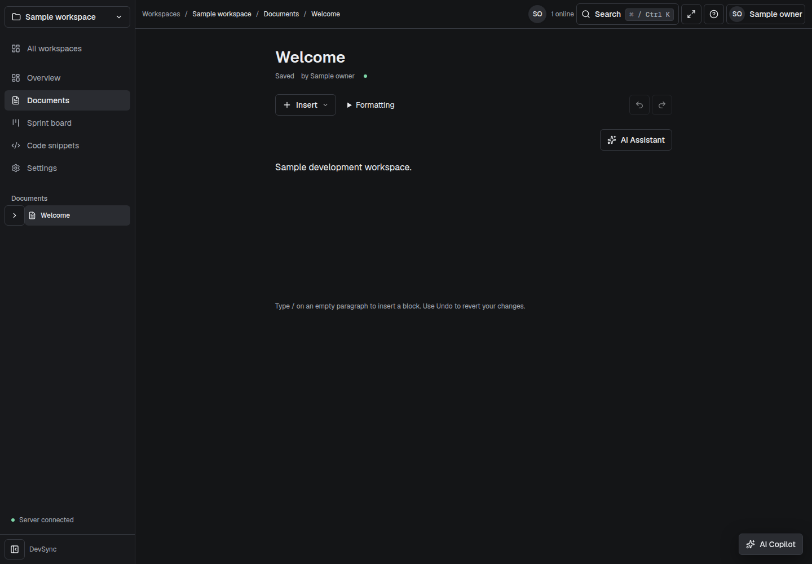
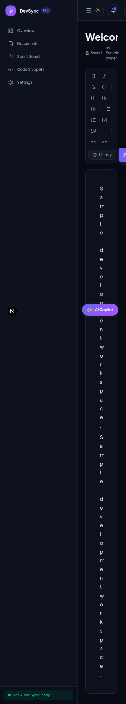
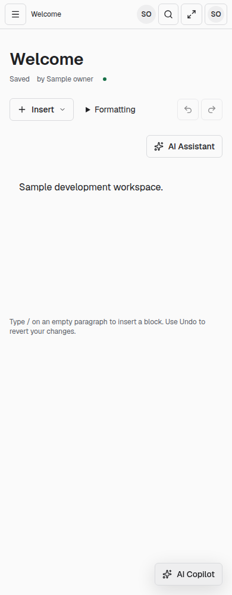
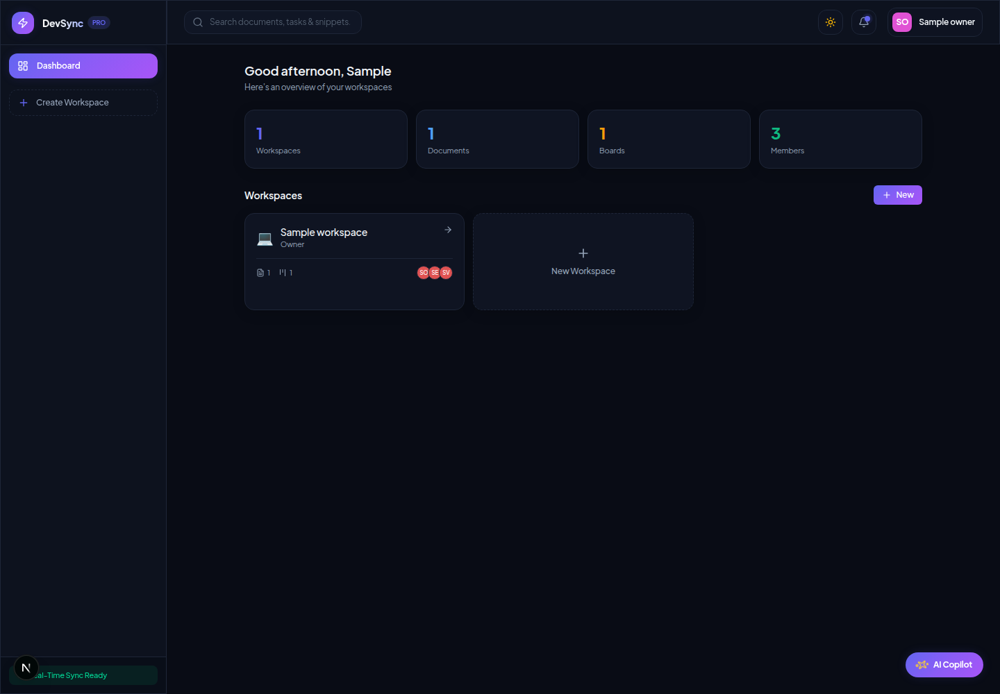
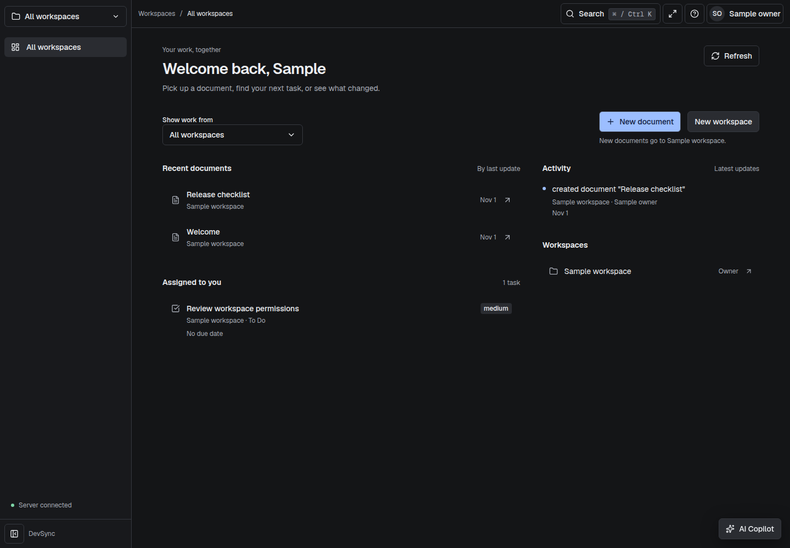

# Final report — documentation handoff

Phase5c, `upgrade/enterprise`. This is an evidence inventory, not production approval. Application behavior was not changed in this session. Earlier measurements retain their original scope/date; no fresh security scan, browser run, hosted deployment, provider sign-in or performance benchmark is implied by the documentation refresh. [Progress](PROGRESS.md) retains chronological failures and deferrals.

## Before and after: measured scope

The initial source audit was2026-10-31. Its [execution ledger](audit-evidence/RESULTS.md) and raw outputs are the baseline. Later results come from [Phase5a](quality/README.md), [Phase5b](deployment/RESULTS.md), [Phase5a-2](quality/phase5a-2/README.md) and [Phase5a-3](quality/phase5a-3/README.md). Different tool versions, source revisions, coverage scopes and container identities prevent treating these as a controlled performance experiment.

| Check                                | Before                                                                     | Recorded later result                                                                                                                         | Evidence / interpretation                                                                                                                                                                                                                        |
| ------------------------------------ | -------------------------------------------------------------------------- | --------------------------------------------------------------------------------------------------------------------------------------------- | ------------------------------------------------------------------------------------------------------------------------------------------------------------------------------------------------------------------------------------------------ |
| Backend lint                         | Script missing                                                             | Pass                                                                                                                                          | Initial ledger versus [Phase5a-3 gate records](quality/phase5a-3/gates/backend-gates.json).                                                                                                                                                      |
| Frontend lint                        | 105 problems:52 errors,53 warnings                                         | Pass                                                                                                                                          | Initial ledger versus [later gate records](quality/phase5a-3/gates/frontend-gates.json).                                                                                                                                                         |
| Strict types / builds                | Both final checks passed after environment retries                         | Both passed                                                                                                                                   | These were not initially failing product metrics to claim as an improvement.                                                                                                                                                                     |
| Backend tests                        | 2 suites passed,2 failed to compile;3 individual tests passed              | 28 suites,260 tests passed                                                                                                                    | [Phase5a-3 raw Jest output](quality/phase5a-3/gates/backend-tests.txt); suite scope grew substantially.                                                                                                                                          |
| Frontend tests                       | No test script                                                             | 17 files,76 component tests passed, plus separate Node runner                                                                                 | [Raw frontend output](quality/phase5a-3/gates/frontend-tests.txt). Do not add file-level Node subtests to component counts.                                                                                                                      |
| Coverage                             | Not measured in the initial audit                                          | Backend statements80.93%, branches71.39%, functions74.69%, lines83.17%; frontend41.19%,38.62%,39.47%,41.67%                                   | Phase5a-3 raw gate coverage tables; frontend [V8 summary](quality/phase5a-3/gates/frontend-coverage/coverage-summary.json). Different scopes, not full end-user behavior coverage.                                                               |
| npm audit, backend full tree         | 2 Critical,12 High,31 Moderate,4 Low                                       | Last Phase5a audit:0 Critical,0 High,41 Moderate,2 Low; production-only7 Moderate                                                             | [Initial audit](audit-evidence/backend-audit-escalated.json), [Phase5a full](quality/backend-npm-audit.json), [production](quality/backend-npm-audit-production.json). Not a fresh scan of Phase5a-3/5c.                                         |
| npm audit, frontend full tree        | 2 Critical,16 High,54 Moderate,1 Low                                       | Last Phase5a audit:0 Critical,0 High,16 Moderate,0 Low; production-only0                                                                      | [Initial audit](audit-evidence/frontend-audit-escalated.json), [Phase5a full](quality/frontend-npm-audit.json), [production](quality/frontend-npm-audit-production.json). Advisory entries are not exploit counts.                               |
| Current-branch container remediation | Phase5a-2 images each1 Critical,32 High                                    | Phase5a-3 backend0 Critical/44 High/75 Medium/60 Low/8 Unknown; frontend0/44/71/60/8                                                          | [Per-package inventory](quality/phase5a-3/VULNERABILITIES.md), [machine-readable result](quality/phase5a-3/RESULTS.json). Critical fixed; High count increased. Earlier cached April image was unrelated, not the before artifact.               |
| Secret scan                          | No comparable initial clean-history measurement                            | Phase5a-2:66 commits,0 findings after two exact non-credential exceptions; five detection regression cases                                    | [Phase5a-2 report](quality/phase5a-2/README.md). Not a scan of subsequent commits or proof no credential ever escaped.                                                                                                                           |
| Source scan                          | No comparable initial measurement                                          | Phase5a Semgrep:74 rules,214 targets, one GCM finding initially, zero on the final affected scan                                              | [Phase5a report](quality/README.md). Not hosted CodeQL or a penetration test.                                                                                                                                                                    |
| Browser E2E                          | 2 skipped,0 executed due missing identity state                            | Latest shell selection7 passed,0 failed,1.1m                                                                                                  | [Raw shell run](quality/phase5a-3/accepted-final-browser.txt). Broader core pointer drag still open; not all suites green.                                                                                                                       |
| Four visual blockers                 | Phase5a affected run4 passed/4 failed                                      | All four original cases pass in final7-test shell selection;40 comparisons                                                                    | [Review](quality/phase5a-3/VISUAL_REVIEW.md), [11 individual intentional redesign baseline reasons](quality/phase5a-3/baseline-review.json). Tolerance remains0.002. Actual renewal/settling defects were fixed before accepting redesign drift. |
| Shell axe                            | Initial audit did not measure comparable shell states                      | 40 reports,0 violations,26 incomplete rule occurrences                                                                                        | [Result totals](quality/phase5a-3/RESULTS.json), raw reports in [accepted-final](quality/phase5a-3/accepted-final). Incompletes are not passes or proof of full WCAG conformance.                                                                |
| One-command startup                  | Initial backend could start but Redis refused connections and readiness503 | Final hardened isolated Compose graph passed in19.249s; migrations/seed, UID1000 services, liveness200, protected401 and keyless readiness503 | [Compose evidence](quality/phase5a-3/compose). Cached local functional startup, not a production/cold-cache benchmark. Earlier clean-checkout verification is in [Phase5b](deployment/RESULTS.md).                                               |

### Measurements unavailable

Lighthouse for landing/dashboard/editor on mobile/desktop was not run: tool installation and authenticated production profiling were deferred in the bounded quality sessions. No scores or Core Web Vitals are supplied. Emitted bundle byte/compression measurements exist in [bundle-sizes.json](quality/bundle-sizes.json), but module attribution, route transfer sizes and demonstrated speedups do not.

k6 was not executed. [load.js](../tools/quality/load.js) is an unvalidated REST-only workload, not a WebSocket editor capacity harness. No p50/p95 or sustained concurrent-editor count exists. Two-client correctness tests are not load measurements. Hosted CI, real Clerk sign-in, production deployment, backup/restore/PITR drills and actual provider cost reconciliation were not performed. Documentation cannot fill these gaps with estimates.

## Real screenshots

The before reference uses main@9deffe28 with a local auth/proxy/runtime adapter and a disposable current backend, as documented in [the capture manifest](ui/before/README.md). It is a UI reference, not pristine-main security/provider evidence. After captures use seeded test identities; timestamps, content and styling differ. Screenshots do not measure performance or prove access control.

| Surface          | Before                                                                                      | After                                                                               |
| ---------------- | ------------------------------------------------------------------------------------------- | ----------------------------------------------------------------------------------- |
| Editor,1440px    |  |  |
| Editor,390px     |    |  |
| Dashboard,1440px |                                            |                |

The before collector recorded a zero-width mobile document title. The accepted current mobile image shows the title; broader responsive/accessibility completeness is still bounded by the exercised tests. Additional feature captures and review notes remain in [ui/after](ui/after).

## Remaining risks and deferred delivery

1. **Release security gate:**44 High entries remain in each runtime image. [Accepted-risk conditions](quality/phase5a-3/accepted-risks.json) explain exact package/CVE/privilege/reachability limits; they do not suppress findings or waive the unchanged High CI gate. Reassess before rollout and when patched stable packages become available. Last npm audits still have Moderate advisories and are not current-commit scans.
2. **Browser/accessibility:** broad native pointer-drag journey still fails; full current multi-suite E2E is not demonstrated.26 shell axe incomplete occurrences and other manual contrast/screen-reader/zoom checks are not automatic passes. Shell success does not certify all pages.
3. **Runtime/security work:** legacy cookie-clearing GET/CSRF migration, bounded isolated OCR/PDF extraction and account-wide credential/session lifecycle remain incomplete. Historical host execution was disabled; possible old exposure requires operator review rather than an unsupported assertion that no exposure occurred.
4. **AI/data integrity:** ambiguous remote billing cannot be made exactly-once by a local reservation. Redis state loss, delayed worker recovery, embedding freshness across continuous CRDT edits and partial indexing/accounting retain documented limits. No model evaluation corpus/results, strict currency ceiling, verified factual citation support or vendor no-training assurance exists.
5. **Operations/evidence:** performance/capacity, hosted CI, identity-provider integration, production isolation, exact scanned-image promotion on Railway, restore/PITR/cutover and RPO/RTO remain unverified. Railway rebuilds reviewed source; it does not prove promotion of CI's exact digest. Terraform/Kubernetes examples are not a tested rollout.
6. **Product deferrals:** full PWA/offline, broad import/export, sessions/2FA admin, API-token UI, audit-log UI, account export/deletion, i18n and advanced editor/board/snippet items remain as individually recorded in [PROGRESS](PROGRESS.md). Installed packages and route labels do not establish completed capabilities.
7. **Privacy/governance:** no complete retention/rights/erasure workflow, cross-system cleanup, verified incident response contact, vendor/legal review or tracked LICENSE grant. Archived content, queues, local copies and backups can retain personal/confidential data. See [PRIVACY](PRIVACY.md) and [SECURITY](../SECURITY.md).

## Requires human action

This consolidates the operational categories in chronological progress notes; no item is implied completed by a config file or mock.

| Area                         | Required action before relying on it                                                                                                                                                                                                                                                                                                                                                              |
| ---------------------------- | ------------------------------------------------------------------------------------------------------------------------------------------------------------------------------------------------------------------------------------------------------------------------------------------------------------------------------------------------------------------------------------------------- |
| Release and measurements     | Review remaining High/Moderate findings and accepted conditions, obtain current evidence, fix outstanding browser flow, finish manual accessibility, Lighthouse/bundle attribution and authorized load/capacity tests. Do not bypass the current gate.                                                                                                                                            |
| Identity                     | Configure actual Clerk application/keys/origins/methods, owner/editor/viewer provider identities and verified emails. Review existing seed mapping and invitation identities; verify real sign-in, revocation and any required MFA/SSO. Seeds are not Clerk users.                                                                                                                                |
| Database/Redis               | Provision pgvector, distinct migration/runtime roles, grants/RLS and private connections. Review baseline adoption on a clone of existing data. Use shared standalone Redis with AOF/noeviction; cluster hash-slot compatibility is not supplied by the quota implementation. Establish backup access/retention and restore admission-state policy.                                               |
| Hosting, domains and CI      | Configure Vercel/Railway IDs/tokens, roots, public build URLs and runtime secrets; review/import Railway IaC against the actual account/plan. Configure protected GitHub environments, reviewers and required checks, disable competing auto-deploys, isolate staging, own preview aliases/domains/TLS, and execute hosted workflows after an authorized push. A provider plan may incur charges. |
| AI and spend                 | Supply optional Groq/OpenAI keys/models, verify embedding1536 dimensions and provider availability, set request allowances and provider-side spending caps, review pricing/free-tier limits/retention/DPAs/transfers. No paid service or key is required for ordinary keyless setup guidance. Live AI needs configured external accounts.                                                         |
| Integrations                 | Supply actual GitHub repository/column mappings and webhook secrets; configure Stripe webhook/meter/billing accounts only if using that integration. Verify delivery/replay behavior privately. Optional Cloudinary service credentials are not proof of an upload product.                                                                                                                       |
| Observability                | Configure protected metrics, OTEL/Sentry destinations if used, private access, redaction/retention and incident owners. Review legacy worker/DLQ payload/error handling before exporting telemetry.                                                                                                                                                                                               |
| Recovery                     | Perform isolated backup/restore/PITR and rollback/cutover drills, set measured RPO/RTO, protect role/key backups, reconcile authority and quota/billing after restores. The instructions are not a restoration result.                                                                                                                                                                            |
| Key rotation                 | Review possible historical execution/credential exposure. Rotate affected Clerk, database, Redis, GitHub, AI, Stripe, deployment and telemetry credentials privately when warranted. AES-GCM ENCRYPTION_KEY rotation needs a reviewed re-encryption procedure/tool and recovery backup; no keyring/automatic rotation is provided.                                                                |
| Feature operations           | Enable optional flags consistently only after migrations; establish expiry cleanup for inactive idempotency receipts, quarantined/DLQ jobs and other retained records. Verify SCIM with the actual identity provider; do not advertise generalized interoperability.                                                                                                                              |
| Legal and project governance | Determine operator/controller/fiduciary, contact and incident process; review GDPR/DPDP applicability/commencement, lawful basis/notices, children, vendor contracts/transfers, retention, rights/export/deletion and breach obligations with counsel. Choose licensing/contribution terms. No legal compliance or reviewed policy approval has been established.                                 |

## Mocks, fixtures and scaffolds

- The isolated browser authentication strategy and generated frontend adapter substitute seeded test identity for Clerk only in test tooling. They do not demonstrate real sign-in and must not be deployed as normal login.
- Deterministic AI provider/stream fixtures, fake error/clock/quota cases and simulated evaluation scorers test interfaces and failure handling. Their outputs are not live-provider quality, latency, cost or factuality measurements. [AI evaluation](../backend/testing/ai-eval/README.md) is intentionally only a case format/runner/scoring scaffold, without a dataset or scores.
- Unit mocks and disposable external-service fixtures exercise policy paths; no successful GitHub/Stripe/SSO/SCIM/cloud deployment is inferred from them. Optional features' test adapters are described in their [feature docs](features).
- Evidence-only digest and manual decision receipts do not require a model. Snippet safety uses bounded heuristics locally, not a paid detection API. No production mock adapter is represented as a real paid integration.

## How to run everything

Use disposable data and keep private values out of output. These are instructions for future execution; only the results explicitly attributed above or in the Phase5c record were run.

1. **Local product:** clone the branch and run `docker compose up --build --detach --wait` as in [README](../README.md). Configure Clerk before private workspace use. [RUNBOOK](RUNBOOK.md) lists exact local/production variables, migrations/grants, provider setup and backups.
2. **Source gates:** install both lockfiles with npm ci, then run all backend and frontend lint, format:check, typecheck, test and build commands from [CONTRIBUTING](../CONTRIBUTING.md). Backend tests require Docker. For raw captured gates, `python3 tools/quality/gates.py backend docs/quality/<run>` followed sequentially by the frontend equivalent runs those same commands. Do not point tests/seeds at production.
3. **API contract:** `npm --prefix backend run openapi:check`; inspect [OpenAPI](../backend/openapi.json) and [API.md](API.md). Regeneration writes the artifact and is a separate intentional contract change.
4. **Seeded E2E/visuals:** with compatible Playwright Chromium, run `node tools/ci/browser.mjs shell`; select core, editor, dashboard, settings, kanban, ai-cost, decisions, snippet-safety or async-digest individually as described in [fixture instructions](../backend/testing/README.md). Each creates isolated services; do not add suite totals across failed/interrupted runs. View expected/actual/diff before any baseline decision.
5. **Security/coverage CI:** [.github/workflows](../.github/workflows) defines audits, Semgrep, Gitleaks, Trivy, dependency caches, coverage comparison, SBOM/attestation and browser jobs. Hosted execution needs an authorized push and repository settings; no act run is required or claimed. Keep unsuppressed raw findings and do not treat a failing security gate as a successful release.
6. **AI evaluation/performance:** follow the [evaluation README](../backend/testing/ai-eval/README.md) with explicitly authorized cases/providers; example formats are not a dataset. The prepared REST-only k6 workload and missing Lighthouse work require separate authorized setup/execution; no command here claims completed measurements.
7. **Preview/production and recovery:** follow [RUNBOOK](RUNBOOK.md), configure protected environments/accounts, use reviewed SHAs and run migrations with the separate privileged role. Deployment, restoration and key rotation are human-authorized operations, not consequences of opening these docs.

## Phase5c verification

Both applications passed lint, format, strict types, tests and build in this documentation session: backend28 suites/260 tests; frontend17 files/76 component tests and9 separate Node tests. Current backend coverage is statements80.88%, branches71.34%, functions74.69%, lines83.17%; frontend41.19%,38.62%,39.47%,41.67%. The small backend statement/branch variation from the earlier snapshot is retained in the raw tables; no source, test or threshold was changed to force a percentage.

This session's exact commands, gate exits and raw logs are retained in [quality/phase5c](quality/phase5c). The documentation link inventory checks local targets; it is not an external-link uptime, rendered Mermaid, legal or operational validation. No application code, baseline or contract changes were needed. No new performance/security/browser result is claimed.
